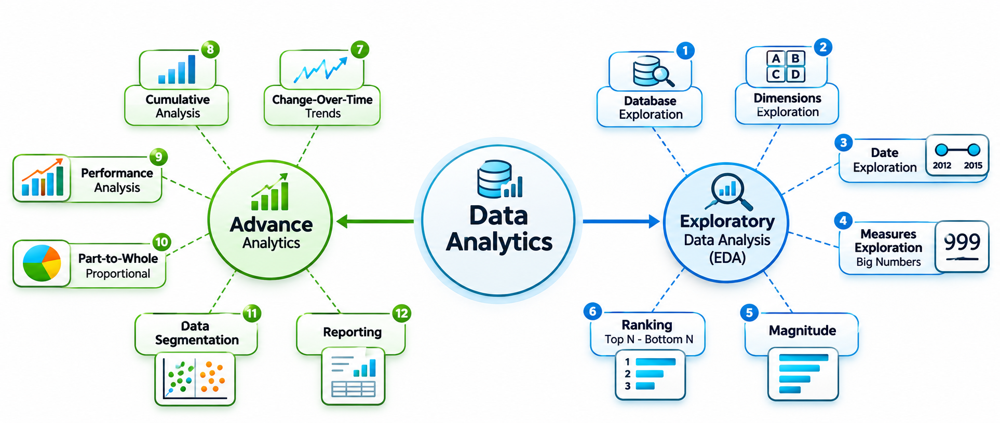

# SQL Exploratory Data Analytics Project

An end-to-end SQL project focused on exploring business data, analyzing sales performance, and generating customer and product insights using Microsoft SQL Server.

## Project Objectives

- Explore and understand the available datasets.
- Calculate key business metrics and KPIs.
- Analyze customer and product performance.
- Identify sales trends and patterns.
- Segment customers and products.
- Answer business questions using SQL.

## Project Roadmap

The following roadmap illustrates the analytical workflow and the main topics covered in this project.



## Analysis & Techniques

The project covers several analytical techniques:

| Analysis | Description |
|---|---|
| Database Exploration | Explore tables, columns, and data structures |
| Dimensions Exploration | Understand the different dimensions |
| Date Exploration | Analyze date ranges and time periods |
| Measures Exploration | Calculate key business metrics and KPIs |
| Magnitude Analysis | Compare metrics across different categories |
| Ranking Analysis | Identify top and bottom products and customers |
| Change Over Time | Analyze sales trends over time |
| Cumulative Analysis | Calculate running totals and cumulative metrics |
| Performance Analysis | Evaluate product performance over time |
| Part-to-Whole | Analyze category contributions to total sales |
| Data Segmentation | Group customers and products into segments |
| Reporting | Create customer and product analytical reports |

## Customer & Product Reports

Two analytical SQL Views were created:

- **`gold.report_customers`** – Customer segmentation, age groups, purchasing behavior, and customer-level KPIs.
- **`gold.report_products`** – Product segmentation, revenue performance, and product-level KPIs.

## Technologies

- Microsoft SQL Server
- SQL / T-SQL
- Aggregate Functions
- JOINs and CTEs
- Subqueries
- Window Functions
- CASE WHEN
- Date Functions
- SQL Views

## Repository Structure

```text
sql-exploratory-data-analysis-project/
│
├── datasets/
│
├── docs/
│   └── Roadmap.png
│
├── scripts/
│   ├── 00_init_database.sql
│   ├── 01_database_exploration.sql
│   ├── 02_dimensions_exploration.sql
│   ├── 03_date_range_exploration.sql
│   ├── 04_measures_exploration.sql
│   ├── 05_magnitude_analysis.sql
│   ├── 06_ranking_analysis.sql
│   ├── 07_change_over_time_analysis.sql
│   ├── 08_cumulative_analysis.sql
│   ├── 09_performance_analysis.sql
│   ├── 10_part_to_whole_analysis.sql
│   ├── 11_data_segmentation.sql
│   ├── 12_report_customers.sql
│   └── 13_report_products.sql
│
├── LICENSE
└── README.md
